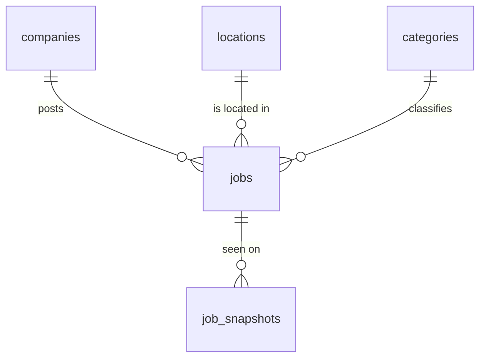

# Job Market SQL Pipeline
[](https://github.com/mkplwro/job-market-sql-pipeline/actions/workflows/daily_collection.yml)

An automated ETL pipeline that collects data analyst job postings in Wrocław from the [Adzuna API](https://developer.adzuna.com/) and stores them in a PostgreSQL database (hosted on Neon) for SQL analysis.

## How it works

```
Adzuna API → transform (Pandas) → data quality checks → PostgreSQL (Neon)
```

- **Collection** – fetches up to 250 current "data analyst" offers in Wrocław (5 pages × 50).
- **Transformation** – flattens nested API fields, parses dates and removes duplicates. Intermediate files are generated at runtime and are not stored in git.
- **Data quality** – a report on missing values, duplicate IDs, invalid salary ranges and dates is printed in every run.
- **Loading** – new companies, locations, categories and jobs are added to the database. Existing records are never duplicated, so the pipeline is safe to re-run.
- **Daily snapshots** – every run records which jobs are still active, so the data can show how long offers stay open and how the market changes over time.
- **Automation** – GitHub Actions runs the full pipeline every day (06:17 UTC).

## Data scope

Offers are collected daily since 2026-10-04. This is a small sample from one city and one search query, so the results describe this dataset and are not representative of the whole job market.

## Database model



## SQL analysis

| File | Contents |
|---|---|
| [`01_schema.sql`](sql/01_schema.sql) | Table definitions, keys and constraints |
| [`02_basic_analytics.sql`](sql/02_basic_analytics.sql) | `JOIN`s, `GROUP BY`, aggregates with `FILTER`, subqueries: market size per day, offers by category and company, salary statistics (real salaries only, predicted ones excluded), new and disappearing offers per day |
| [`03_advanced_analytics.sql`](sql/03_advanced_analytics.sql) | CTEs and window functions on the daily snapshots |

## Limitations

- Small sample: one city, one search query, up to 250 offers per run.
- An offer that disappears from the results was not necessarily filled (it may have expired or been removed), so "offer lifetime" is not "time to hire".
- Salary figures come only from offers that state them; salaries predicted by Adzuna are excluded from salary statistics.

## Tech stack

Python 3.12 · Pandas · PostgreSQL (Neon) · SQL · psycopg2 · REST API · GitHub Actions

## Project structure

```
├── .github/workflows/   # daily pipeline run
├── sql/                 # schema and analysis queries
├── src/                 # ETL scripts and pipeline runner
├── .env.example         # required environment variables
└── requirements.txt
```

## Getting started

```bash
git clone https://github.com/mkplwro/job-market-sql-pipeline.git
cd job-market-sql-pipeline
pip install -r requirements.txt
```

1. Create the tables in your PostgreSQL database with `sql/01_schema.sql`.
2. Copy `.env.example` to `.env` and fill in:
   - `ADZUNA_APP_ID`, `ADZUNA_APP_KEY` – Adzuna API credentials
   - `CLOUD_DB_HOST`, `CLOUD_DB_PORT`, `CLOUD_DB_NAME`, `CLOUD_DB_USER`, `CLOUD_DB_PASSWORD` – database connection
3. Run the pipeline:

```bash
python src/pipeline.py
```
4. Run the queries from `sql/02_basic_analytics.sql` and `sql/03_advanced_analytics.sql` in any SQL client.

## Roadmap

- Longer-term trend analysis as more daily snapshots accumulate
- Reporting and visualizations

## Status

In progress – new features are added regularly.