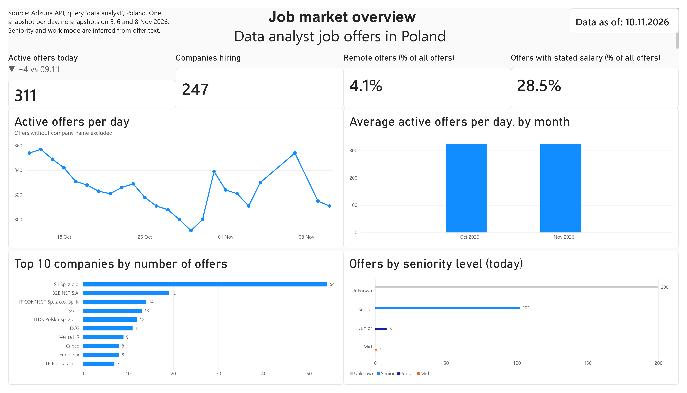
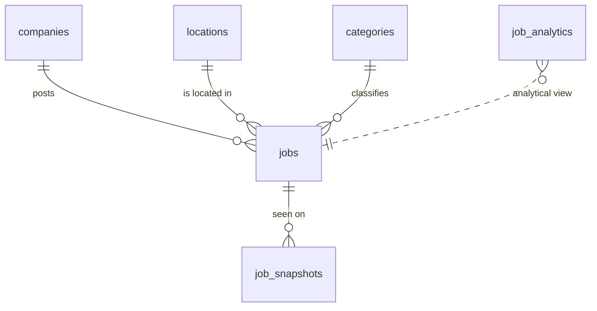

# Job Market SQL Pipeline

[](https://github.com/mkplwro/job-market-sql-pipeline/actions/workflows/daily_collection.yml)

An automated ETL and analytics project that collects Data Analyst job postings in Poland from the Adzuna API and stores them in a PostgreSQL database (hosted on Neon). The data is used for SQL analytics, a Power BI report, exploratory data analysis and job market forecasting with machine learning.

## Dashboard



*Power BI report connected to the Neon database (data as of November 10, 2026).*

The first page of the report shows active offers per day and per month, top companies, offers by seniority level, and the share of remote offers and offers with a stated salary.

## Tech stack

Python 3.12 · Pandas · scikit-learn · Jupyter Notebook · PostgreSQL (Neon) · SQL · psycopg2 · REST API · GitHub Actions · Power BI

## How it works

```
Adzuna API → transform (Pandas) → data quality checks → PostgreSQL (Neon) → EDA → ML models
```

- **Collection** – fetches up to 1000 current "data analyst" offers in Poland (20 pages × 50).
- **Transformation** – flattens nested API fields, parses dates and removes duplicates. Intermediate files are generated at runtime and are not stored in git.
- **Data quality** – a report on missing values, duplicate IDs, invalid salary ranges and dates is printed in every run.
- **Loading** – new companies, locations, categories and jobs are added to the database. The snapshot for the current date is replaced in a single transaction and committed only after validation, so re-running the pipeline on the same day does not create duplicates.
- **Daily snapshots** – every run records which jobs are still active, so the data can show how long offers stay open and how the market changes over time.
- **Automation** – GitHub Actions runs the pipeline daily (scheduled for 06:17 UTC).

## Database and SQL analysis

### Database model



### SQL analysis

| File                                                         | Contents |
|--------------------------------------------------------------|---|
| [`01_schema.sql`](sql/01_schema.sql)                         | Table definitions, primary keys, foreign keys and constraints |
| [`02_job_analytics.sql`](sql/02_job_analytics.sql)           | Creation of the `job_analytics` analytical view, combining job, company and location data, with job seniority classification |
| [`03_basic_analytics.sql`](sql/03_basic_analytics.sql)       | `JOIN`s, `GROUP BY`, aggregates with `FILTER`, subqueries: market size per day, offers by category and company, salary statistics (real salaries only, predicted ones excluded), new and disappearing offers per day |
| [`04_advanced_analytics.sql`](sql/04_advanced_analytics.sql) | CTEs and window functions on daily snapshots, including offer retention and changes in the job market |

## Data scope and limitations

Data collection started on October 15, 2026. Three days have no snapshot:

- November 5 and 6: the pipeline did not run.
- November 8: the snapshot was a copy of November 7 (caused by incorrect file paths), so it was removed.

These problems have been fixed. The missing days are treated as missing data, not as "no change" in the job market.

- **Small sample:** The data comes from one source (Adzuna), one country and one search query. Each run collects up to 1,000 offers. It does not show the whole Polish job market.
- **Short job descriptions:** The API gives only short parts of the job descriptions.
- **Approximate classification:** Seniority and work mode are inferred from the offer text, so these numbers are approximate.
- **Duplicate offers:** The same job can be posted by several recruitment agencies. This can make the number of offers per company look higher.
- **Offer lifetime:** An offer can disappear from the results because it was filled, expired, was removed or simply did not appear in the API results. So offer lifetime is not the same as time to hire.
- **Salary data:** Salary statistics use only offers that state a salary. Salaries estimated by Adzuna are not included.

## Getting started

### 1. Clone the repository

```bash
git clone https://github.com/mkplwro/job-market-sql-pipeline.git
cd job-market-sql-pipeline
```

### 2. Set up the Python environment

```bash
python -m venv .venv
```

Activate the environment:

- Linux / macOS: `source .venv/bin/activate`
- Windows (PowerShell): `.venv\Scripts\Activate.ps1`
- Windows (cmd): `.venv\Scripts\activate.bat`

Install dependencies:

```bash
pip install -r requirements.txt
```

### 3. Configure the database

Create the database tables and analytical view in PostgreSQL using the SQL scripts in the `sql/` directory. Execute them in the following order:

- `01_schema.sql` – creates database tables and constraints.
- `02_job_analytics.sql` – creates the analytical view.

### 4. Configure environment variables

Copy `.env.example` to `.env` and provide the required credentials:

- `ADZUNA_APP_ID`, `ADZUNA_APP_KEY` – Adzuna API credentials.
- `CLOUD_DB_HOST`, `CLOUD_DB_PORT`, `CLOUD_DB_NAME`, `CLOUD_DB_USER`, `CLOUD_DB_PASSWORD` – PostgreSQL database connection credentials.

### 5. Run the ETL pipeline

```bash
python src/pipeline.py
```

### 6. Explore the results

Run the queries from `sql/03_basic_analytics.sql` and `sql/04_advanced_analytics.sql` in any PostgreSQL-compatible SQL client. Notebooks with exploratory data analysis and machine learning experiments are in the `notebooks/` directory.

## Project structure

<details>
<summary>Show folder structure</summary>

```
├── .github/
│   └── workflows/          # GitHub Actions daily pipeline
├── docs/                   # dashboard screenshot
├── sql/                    # database schema, analytical views and SQL queries
├── src/
│   ├── data_collection/    # Adzuna API data collection
│   ├── data_processing/    # data transformation and quality checks
│   ├── database/           # database creation, loading and migration
│   ├── forecasting/        # forecasting data preparation and feature engineering
│   └── pipeline.py         # main ETL pipeline runner
├── notebooks/              # EDA and ML experiments
├── tests/                  # API and database tests
├── .env.example            # required environment variables
└── requirements.txt        # Python dependencies
```

</details>

## Status

Currently working on EDA for machine learning models for job market forecasting.